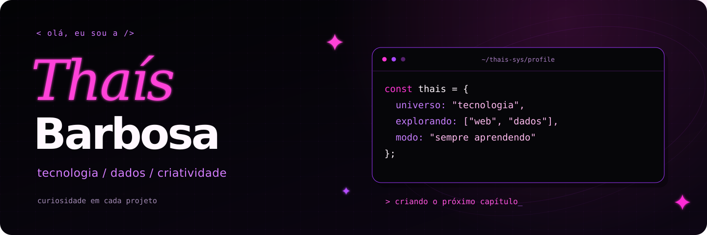
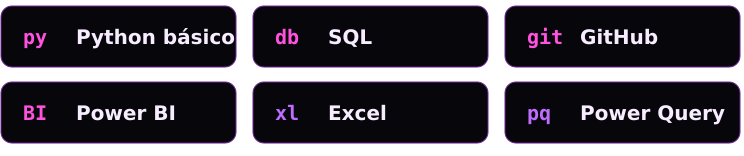
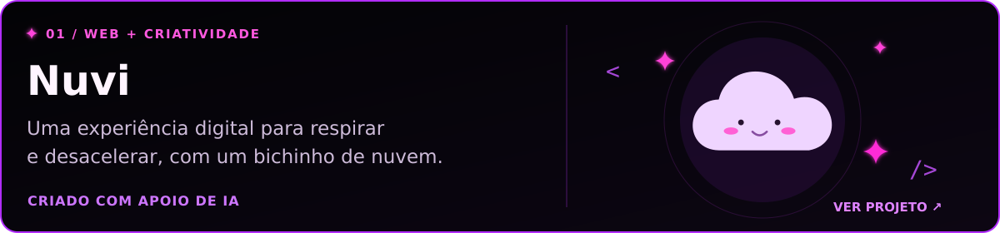
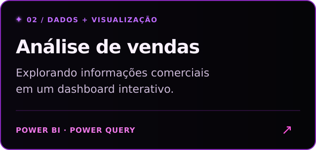
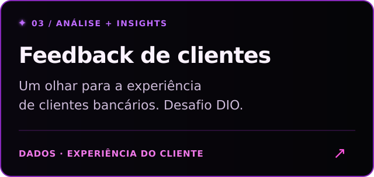

  <picture>
    <source media="(max-width: 600px)" srcset="assets/banner-mobile.svg">
    
  </picture>

  <a href="#sobre">sobre mim</a> &nbsp; ✧ &nbsp;
  <a href="#stack">tech stack</a> &nbsp; ✧ &nbsp;
  <a href="#projetos">projetos</a>

## ✦ Sobre mim

Sou a **Thaís**, Analista de Dados Júnior, em Porto Alegre. Este é meu espaço para compartilhar aprendizado, projetos de dados e experiências web.

Entre código, análise e criatividade, transformo ideias em projetos e registro minha evolução em tecnologia. ˖ ࣪⊹

## ⌘ Tech stack

  <picture>
    <source media="(max-width: 600px)" srcset="assets/stack-mobile.svg">
    
  </picture>

## ✧ Projetos & ideias

  <a href="https://github.com/thais-sys/nuvi">
    <picture>
      <source media="(max-width: 600px)" srcset="assets/project-nuvi-mobile.svg">
      
    </picture>
  </a>

  
  

---

  <strong>um projeto de cada vez, um pouco mais de mim em cada um.</strong> 
  <a href="https://github.com/thais-sys?tab=repositories">explore meus repositórios ↗</a>

